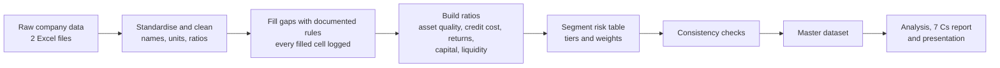

<div align="center">

# NBFC Credit Analysis
### Bajaj Finance vs Mahindra Finance · FY2016-17 to FY2025-26

A ten-year, data-driven comparison of two of India's largest non-banking finance companies, covering asset quality, credit cost, profitability, capital, liquidity and segment risk.


[Overview](#overview) · [Key findings](#key-findings) · [Methodology](#methodology) · [Repository structure](#repository-structure) · [How to run](#how-to-run) · [Data quality and caveats](#data-quality-and-caveats) · [Author](#author)

</div>

---

## Overview

Non-banking finance companies (NBFCs) lend to customers that banks often do not reach, so their credit risk matters for both investors and regulators. This project compares two very different NBFCs:

- **Bajaj Finance**: a diversified, consumer-led lender (reported on a consolidated basis).
- **Mahindra Finance**: a rural and vehicle-finance lender (reported on a standalone basis).

Using ten years of company disclosures, the project builds one clean company-by-year dataset and asks:

1. How did asset quality (GNPA, NNPA, provision coverage) change over the decade?
2. How much did credit losses cost each company, and how did COVID-19 affect that?
3. Are returns (ROA, ROE) earned with more or less risk?
4. How strong are capital, leverage and liquidity?
5. How risky is each company's loan book by segment?

The analysis follows the **7 Cs of credit analysis** and is presented in a written report and a slide deck.

## Key findings

| Metric | Bajaj Finance | Mahindra Finance |
|---|---|---|
| Gross NPA, FY2017 → FY2026 | 1.68% → 1.01% | 9.0% → 2.9% |
| Lowest Gross NPA in the period | 0.85% (FY2024) | 2.9% (FY2026) |
| Provision coverage, FY2017 → FY2026 | 73.8% → 59.7% | 60.9% → 67.0% |
| Credit cost, COVID peak (FY2021) | 3.98% | 4.90% |
| Return on assets, FY2017 → FY2026 | 3.70% → 4.30% | 1.0% → 1.9% |
| High-risk segment share, FY2017 → FY2026 | 65.0% → 36.8% | 23.0% → 33.0% |

**What stands out**

- Mahindra's asset quality improved sharply, from about 9% Gross NPA to under 3%, while Bajaj stayed low throughout.
- Both companies saw credit cost peak in the COVID year, FY2020-21, and then fall.
- The two moved in opposite directions on segment risk. Bajaj cut its high-risk share by almost half, while Mahindra's grew.
- Bajaj's return on assets stayed well above Mahindra's in every year.

> Figures come from the master dataset in this repository. See the [caveats](#data-quality-and-caveats) before comparing across companies.

## Methodology



**Data preparation**

- Combines Bajaj's topic-wise sheets and Mahindra's annual sheet into one panel of 2 companies × 10 years.
- Converts all ratios to percentages once, and rebuilds missing values from accounting identities. For example, Gross NPA = GNPA % × loan base.
- Logs every imputed value with its method (30 cells filled in total).
- Calculates credit cost and write-offs on **average AUM**, and ROA/ROE on average balances.
- Builds a segment table with a secured/unsecured flag and a risk tier (Low, Medium, Medium-High, High).

**Validation checks**

- No duplicate company-year rows.
- Stage totals compared with the loan base.
- Calculated vs reported GNPA.
- Provision coverage vs Stage 3 ECL cover.
- Write-off roll-forward tested against years with reported write-offs. It was within about 3% in every year tested.

**Outputs**

- A master dataset of 20 rows × 90 columns (company-years), plus a segment table of 160 rows.
- An analysis table with 96.2% of cells filled. Each remaining gap has a stated reason, such as pre-Ind AS years or the LCR rule starting in December 2020.

## Repository structure

```
nbfc-credit-analysis/
├── README.md
├── requirements.txt
├── .gitignore
├── data/
│   ├── raw/
│   │   ├── Bajaj_Finance_10yr_Dataset.xlsx
│   │   └── Mahindra_Data.xlsx
│   └── processed/
│       ├── NBFC_merged_final.xlsx
│       └── NBFC_dashboard_ready.xlsx
├── notebooks/
│   ├── Financial_Assignment.ipynb
│   └── NBFC_Credit_Analytics.ipynb
└── reports/
    ├── Bajaj_vs_Mahindra_7Cs_Combined.pdf
    └── NBFC_Credit_Analysis_Presentation.pptx
```

| File | Purpose |
|---|---|
| `notebooks/Financial_Assignment.ipynb` | Cleans and merges the raw data, imputes gaps with logging, builds ratios and the segment table, runs checks, exports the master dataset |
| `notebooks/NBFC_Credit_Analytics.ipynb` | Analysis and charts built on the cleaned data |
| `data/raw/` | Source datasets for each company |
| `data/processed/NBFC_merged_final.xlsx` | Merged, cleaned master dataset |
| `data/processed/NBFC_dashboard_ready.xlsx` | Summary tables used for the charts and slides |
| `reports/Bajaj_vs_Mahindra_7Cs_Combined.pdf` | Full written analysis using the 7 Cs framework |
| `reports/NBFC_Credit_Analysis_Presentation.pptx` | Slide deck summarising the findings |

## How to run

The notebooks are built for **Google Colab**, because they use Colab's file upload.

1. Open `notebooks/Financial_Assignment.ipynb` in [Google Colab](https://colab.research.google.com/) (File → Upload notebook).
2. Run the first cell and, when asked, upload both files from `data/raw/`.
3. Run the remaining cells in order. The notebook exports `NBFC_master_dataset.xlsx` and `NBFC_master_panel.csv`.
4. Repeat for `notebooks/NBFC_Credit_Analytics.ipynb`.

To run locally, install the requirements and replace the `files.upload()` step with the paths to the raw files:

```bash
pip install -r requirements.txt
jupyter notebook
```

**requirements.txt**
```
pandas
numpy
openpyxl
```

## Data quality and caveats

This is a coursework project built from public disclosures, and some values are estimated. They are flagged in the data.

| Issue | How it is handled |
|---|---|
| Reporting basis differs: Bajaj is consolidated, Mahindra is standalone | Recorded in the `Basis` column |
| Bajaj balance sheet for FY2021–FY2026 is estimated (net worth from ROE and PAT, total assets from equity × leverage, borrowings from total assets) | Flagged `BS_estimated = 1`. ROE and ROA recalculated from estimated equity are left blank to avoid circular logic |
| Missing Bajaj write-offs | Estimated by an ECL roll-forward (opening ECL + impairment − closing ECL) and validated against reported years |
| Mahindra segment-level GNPA is not disclosed | Allocated from total Gross NPA using risk weights, flagged `GNPA_is_modelled = 1` |
| Segment risk tiers and weights (Low 0.5, Medium 1.0, Medium-High 1.5, High 2.0) | These are the author's own judgement, not company data |
| NPA recognition norms changed over time (4-month, 3-month, then strict 90 days past due) | Flagged in the `NPA_norm` column |
| No stage data before Ind AS, and LCR only began in December 2020 | Left blank on purpose |
| Mahindra stage totals differ from its loan base by more than 2% in six years, and its FY2020-21 calculated GNPA differs from the reported figure by more than 0.5 percentage points | Reported in the notebook checks |

## Skills demonstrated

Financial statement and credit-risk analysis · data cleaning and reconciliation · documented imputation · ratio engineering · panel data handling in pandas · Excel reporting · analytical writing and presentation

## Author

**Nandini Sharma**
MSc Economics (2025–27), Symbiosis School of Economics, Pune
GitHub: [@your-username](https://github.com/your-username)

## License

Code is released under the [MIT License](LICENSE). Source data belongs to the respective companies and is used here for educational purposes only. Nothing in this repository is investment advice.
